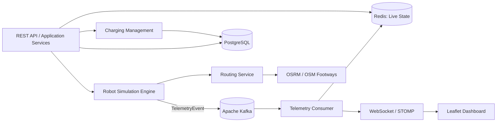

# Robot Fleet — Autonomous Delivery Simulation (Köln)

> **Status: Konzept / geplante Implementierung.** Dieses Repository dokumentiert zunächst die Zielarchitektur. Implementierungsstand und Messergebnisse werden erst nach erfolgreicher Umsetzung ergänzt.

**Robot Fleet** ist ein Java-basiertes Portfolio-Projekt zur Simulation und Verwaltung von **100 bis 1.000 autonomen Lieferrobotern** in Köln. Die humanoiden Roboter sind konzeptionell an Modelle wie den Unitree G1 angelehnt; **es findet keine Steuerung realer Hardware statt**.

Die Plattform simuliert die Auftragszuweisung, Bewegung entlang des Kölner Fußwegenetzes, GPS-Telemetrie, Batterieverbrauch, Ladeplanung und Warteschlangen an virtuellen Ladestationen. Ein Live-Dashboard zeigt die Roboter auf einer interaktiven Karte.

## Projektziele

- Eine nachvollziehbare **Event-Driven-Architektur** mit Kafka entwerfen und implementieren.
- Echtzeit-Telemetrie von 100 bis 1.000 simulierten Robotern verarbeiten und per WebSocket visualisieren.
- **Redis** für flüchtige Live-Zustände und **PostgreSQL** für dauerhafte Geschäftsdaten einsetzen.
- Nebenläufigkeit mit **Java 21**, insbesondere **Virtual Threads für geeignete blockierende I/O-Aufgaben**, praktisch untersuchen.
- Geschäftliche Randfälle, konkurrierende Zugriffe, Ereignisreihenfolge und Fehlerbehandlung durch Tests absichern.
- Entscheidungen und tatsächlich gemessene Leistungskennzahlen dokumentieren.

## Funktionsumfang (geplant)

1. **Flottensimulation:** 100 Roboter als Startkonfiguration; skalierbar bis 1.000. Konfigurierbare Simulationsgeschwindigkeit und Aktualisierungsrate.
2. **Auftragsmanagement:** Erstellen, Zuweisen, Abholen, Ausliefern und Abschließen von Lieferaufträgen.
3. **Fußwegrouting:** Berechnung von Strecken mit **OSRM** und einem tatsächlich für Fußwege vorbereiteten OSM-Routinggraphen. Bewegung entlang von Routenpunkten statt geradliniger Interpolation zwischen Start und Ziel.
4. **Batteriemanagement:** Simulierter Verbrauch abhängig von Wegstrecke und Bewegung; Prüfung der Restreichweite. Unterhalb einer konfigurierbaren Schwelle (anfangs 20 %) werden keine neuen Aufträge angenommen.
5. **Lademanagement:** Geeignete virtuelle Ladestation wählen, Ladeplatz reservieren, bei Bedarf warten und bis 80 % laden. Das Type-2-/OCPP-Szenario ist **eine abstrahierte Simulation**; reale G1-Roboter verfügen dadurch nicht automatisch über Kompatibilität zu Pkw-Ladestationen.
6. **Live-Monitoring:** Roboterposition, Status, Batteriestand, aktuelle Route und Auftragsdaten über WebSocket auf einer Leaflet-/OpenStreetMap-Karte anzeigen.
7. **Betriebsverhalten:** Reconnect, Wiederanlauf, idempotente Ereignisverarbeitung und definierte Reaktionen auf Ausfälle.

## Technologie-Stack (Zielarchitektur)

| Bereich | Technologie | Aufgabe |
| --- | --- | --- |
| Backend | Java 21, Spring Boot | REST-API, Fachlogik, Orchestrierung |
| Messaging | Apache Kafka, Spring Kafka | Entkopplung und Verarbeitung von Telemetrieereignissen |
| Live-State | Redis | Aktuelle Positionen und Roboterzustände |
| Persistenz | PostgreSQL, Spring Data JPA, Flyway | Aufträge, Roboterkonfiguration, Liefer- und Ladehistorie |
| Nebenläufigkeit | Java Virtual Threads | Geeignete konkurrierende, überwiegend I/O-lastige Abläufe |
| Routing | OSRM + OpenStreetMap | Routenberechnung anhand eines Fußwegeprofils |
| Kommunikation | WebSocket / STOMP | Push-Updates an verbundene Browser |
| Frontend | Leaflet.js, OpenStreetMap, HTML/CSS/JavaScript | Live-Karte und Flotten-Dashboard |
| Infrastruktur | Docker Compose | Lokale Entwicklung und reproduzierbarer Start |
| Qualität | JUnit 5, Mockito, Testcontainers | Unit- und Integrationstests |
| Monitoring | Spring Boot Actuator, Micrometer | Health Checks, Laufzeit- und Leistungsmetriken |

## Architektur

**Ansatz: modularer Monolith** mit klar abgegrenzten Fachmodulen. Der Simulator kann innerhalb derselben Anwendung starten; Kafka bildet die asynchrone Grenze zwischen erzeugter Telemetrie und ihrer Verarbeitung. Eine Aufteilung in Microservices ist **nicht** Teil des MVP.



### Datenverantwortung

- **Kafka:** Transport von Telemetrie- und ausgewählten Fachereignissen; Partitionierung von Telemetrie nach `robotId` zur Reihenfolge pro Roboter.
- **Redis:** Momentaufnahme der Flotte (Position, Status, Batteriestand, Zeitpunkt, Sequenznummer); kein Ersatz für die führende Geschäftsdatenbank.
- **PostgreSQL:** Aufträge, Roboter-Stammdaten, Stationen, Ladesitzungen und fachlich relevante Ereignisse. Nicht jeder GPS-Tick muss dauerhaft gespeichert werden.
- **WebSocket:** Überträgt neue Zustände an angemeldete Dashboards. Nach dem Verbinden lädt der Client zunächst einen Snapshot über REST und verarbeitet danach Live-Updates.

### Ereignisfluss

1. Der Simulator berechnet in festen Zeitschritten Position, Batteriestand und Zustand eines Roboters entlang einer vorberechneten Route.
2. Er veröffentlicht ein `RobotTelemetryEvent` in Kafka, mit `eventId`, `robotId`, `sequenceNumber`, `occurredAt`, Position, Batterie und Status.
3. Der Consumer validiert das Ereignis und verwirft Duplikate bzw. veraltete Sequenznummern, bevor er den Live-Zustand aktualisiert.
4. Der WebSocket-Broker überträgt Zustandsänderungen an den Browser. Die Aktualisierungsfrequenz darf für die Darstellung gedrosselt oder gebündelt werden.
5. Dauerhafte geschäftliche Änderungen werden kontrolliert in PostgreSQL gespeichert.

**Zuverlässigkeit:** Kafka ermöglicht erneute Zustellung. Daher ist idempotente Verarbeitung notwendig; eine Ende-zu-Ende-Exactly-once-Garantie wird nicht vorausgesetzt. Fehler, Retries und Dead-Letter-Strategie werden vor Implementierung konkret festgelegt.

## Fachmodell

### Roboterzustände (geplant)

`IDLE` → `ASSIGNED` → `MOVING_TO_PICKUP` → `PICKING_UP` → `DELIVERING` → `IDLE`

Weitere Zustände: `LOW_BATTERY`, `MOVING_TO_CHARGER`, `WAITING_FOR_CHARGER`, `CHARGING`, `ERROR`.

Eine zentrale State Machine soll zulässige Übergänge und ihre Auslöser festlegen. `LOW_BATTERY` wird dabei als Betriebszustand bzw. Ereignis präzisiert, damit er nicht mit der aktuellen Tätigkeit kollidiert.

### Aufträge und Laden

- Aufträge werden nur an verfügbare Roboter mit ausreichender prognostizierter Reichweite vergeben.
- Eine Zuweisung muss **atomar** erfolgen: Ein Roboter darf nicht gleichzeitig zwei inkompatible Aufträge erhalten.
- Der Ladebedarf hängt nicht nur vom aktuellen Prozentwert, sondern auch von der Distanz bis zur erreichbaren Ladestation ab.
- Ladeplätze besitzen eine begrenzte Kapazität. Reservierung und Warteschlange müssen auch unter konkurrierenden Anfragen korrekt funktionieren.
- Der Ladevorgang ist zeitlich simuliert; das Ladeziel beträgt zunächst 80 %.

## Datenbankentwurf (vorläufig)

| Entität | Beispielattribute |
| --- | --- |
| `robots` | `id`, `model`, `capacity_wh`, `status`, `version` |
| `orders` | `id`, `pickup_lat/lon`, `dropoff_lat/lon`, `status`, `assigned_robot_id`, `created_at`, `completed_at` |
| `charging_stations` | `id`, `name`, `lat/lon`, `slot_count`, `enabled` |
| `charging_sessions` | `id`, `robot_id`, `station_id`, `slot_id`, `started_at`, `finished_at`, `start_soc`, `target_soc` |
| `delivery_events` | `id`, `order_id`, `robot_id`, `event_type`, `occurred_at` |

Die endgültigen Beziehungen, Schlüssel, Constraints und Indizes werden im **ER-Diagramm** und mit versionierten **Flyway-Migrationen** dokumentiert. Die Ladeplatzreservierung benötigt eine eindeutige Modellierung der einzelnen Slots.

## Dashboard (geplant)

- Kartenansicht Köln mit animierten Robotermarkern.
- Statusabhängige Marker und Detail-Popup (ID, Batterie, Auftrag, ETA, Distanz).
- Sichtbare Route des ausgewählten Roboters.
- Virtuelle Ladestationen mit freien Plätzen und Warteschlangenlänge.
- Kennzahlen: Flottengröße, aktive Lieferungen, verfügbare Roboter, Lade- und Wartezustände.
- Simulationssteuerung: Start, Pause, Reset, Flottengröße.

> **Demo:** Screenshot/GIF und eine kurze Videodemonstration werden nach Fertigstellung ergänzt.

## Qualitätsanforderungen und Messungen

- Korrekte Zustandsübergänge, keine Doppelzuweisung und keine doppelte Ladeplatzreservierung.
- Definierte Ereignisreihenfolge pro Roboter, Duplikatschutz und reproduzierbare Simulationsfälle.
- Tests für Routingfehler, Kafka-Replays, Redis-Ausfall, Station außer Betrieb und WebSocket-Reconnect.
- Lasttests für 100, 500 und 1.000 Roboter bei z. B. 1 Telemetrieereignis pro Sekunde und Roboter.
- Gemessen werden u. a. **Events/s**, p95-Verarbeitungslatenz, CPU-/RAM-Verbrauch, Consumer-Lag und Browser-Aktualisierung. **Es liegen noch keine Messergebnisse vor.**

## Entwicklungsplan

- [ ] **Phase 0 — Design:** Anforderungen, Use Cases, Zustandsdiagramm, Komponenten-/Sequenzdiagramme, ER-Modell, ADRs.
- [ ] **Phase 1 — Bootstrap:** Git-Repository, Spring-Boot-Maven-Projekt, Docker Compose, Health Checks, Flyway, CI-Grundgerüst.
- [ ] **Phase 2 — Vertical Slice:** 100 simulierte Roboter → Kafka → Redis → WebSocket → Leaflet; noch ohne echtes Routing.
- [ ] **Phase 3 — Routing & Bewegung:** Kölner OSM-Daten, OSRM-Fußwegeprofil, Routenpunkte, zeit- und distanzbasierte Bewegung.
- [ ] **Phase 4 — Lieferaufträge:** REST-Endpunkte, Dispatcher, Datenmodell, Auftragslebenszyklus, atomare Vergabe.
- [ ] **Phase 5 — Batterie & Laden:** Energieverbrauch, Reichweitenprüfung, Stationen, Reservierungen, Warteschlangen, Ladevorgänge.
- [ ] **Phase 6 — Robustheit:** Sequenznummern, Idempotenz, Wiederanlauf, Fehlerfälle, Logging und Metriken.
- [ ] **Phase 7 — Tests & Last:** Testcontainers, Integrations- und Lasttests mit dokumentierten Resultaten.
- [ ] **Phase 8 — Präsentation:** Demo-GIF, Architektur-/ER-Diagramme, Screenshots, README-Status, GitHub Actions und Lebenslauf-Link.

**Definition of Done pro Phase:** Anwendung bzw. Teilfunktion startet reproduzierbar, zentrale Regeln sind getestet, README/Diagramme sind aktuell und der Code ist in einem nachvollziehbaren Commit enthalten.

## Geplante Repository-Struktur

```text
robot-fleet/
├── README.md
├── docs/
│   ├── architecture.md
│   ├── decisions/                 # ADRs
│   ├── diagrams/                  # ER- und Ablaufdiagramme
│   └── development-plan.md
├── docker-compose.yml
├── pom.xml
├── src/
│   ├── main/
│   │   ├── java/de/portfolio/robotfleet/
│   │   │   ├── simulation/
│   │   │   ├── fleet/
│   │   │   ├── orders/
│   │   │   ├── routing/
│   │   │   ├── charging/
│   │   │   ├── telemetry/
│   │   │   └── config/
│   │   └── resources/
│   │       ├── db/migration/
│   │       ├── static/
│   │       └── application.yml
│   └── test/
└── .github/workflows/
```

## Lokaler Start

**Noch nicht verfügbar.** Nach der Bootstrap-Phase werden hier die überprüften Voraussetzungen und Befehle für `docker compose up -d`, `./mvnw spring-boot:run`, Datenbankmigrationen und den Dashboard-Aufruf dokumentiert.

## Architekturentscheidungen (zu dokumentieren)

1. Warum modularer Monolith statt Microservices?
2. Warum Kafka für Telemetrie und Redis für Live-Zustände?
3. Warum PostgreSQL für Geschäftsobjekte statt Speicherung sämtlicher GPS-Ticks?
4. Wann helfen Virtual Threads tatsächlich und wann nicht?
5. Wie werden Routen, Ereignisse, Reservierungen und Ausfälle konsistent behandelt?

## Projektkontext

Dies ist ein **eigenständig entwickeltes Lern- und Portfolio-Projekt**, keine produktiv betriebene Zustellflotte. Die simulierten Roboter, ihre Energieparameter, die Ladeinfrastruktur und die Lieferaufträge sind modellierte Annahmen. Kartendaten stammen aus OpenStreetMap; bei Veröffentlichung sind die jeweiligen Lizenz- und Attributionsbedingungen zu beachten.
